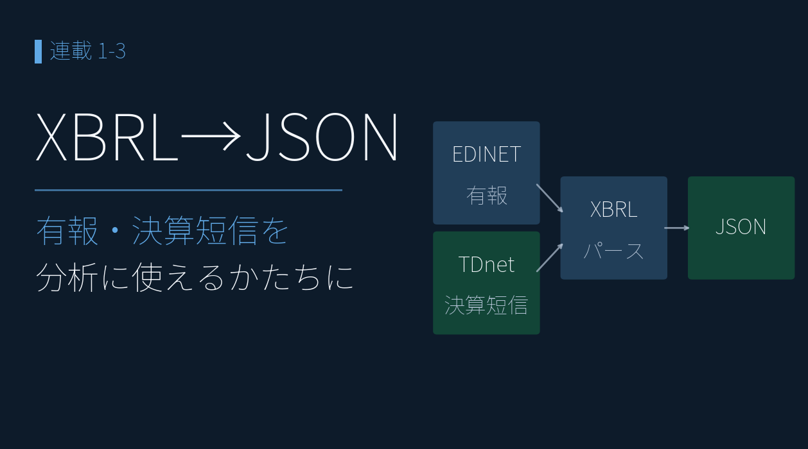
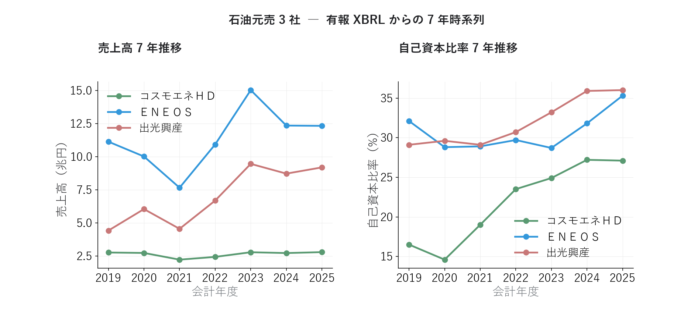
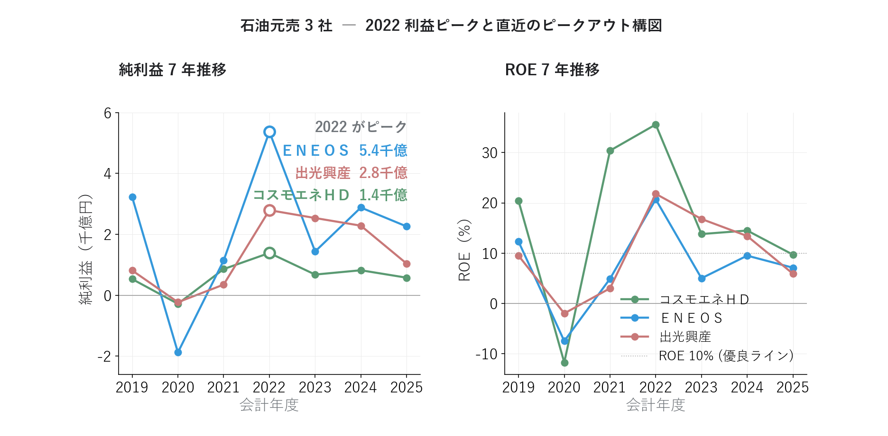
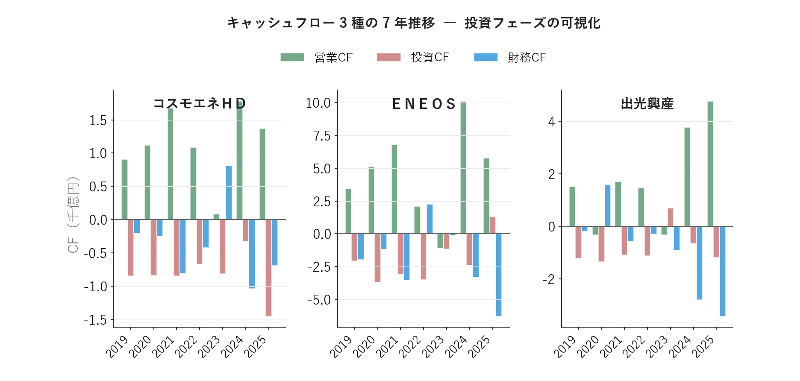
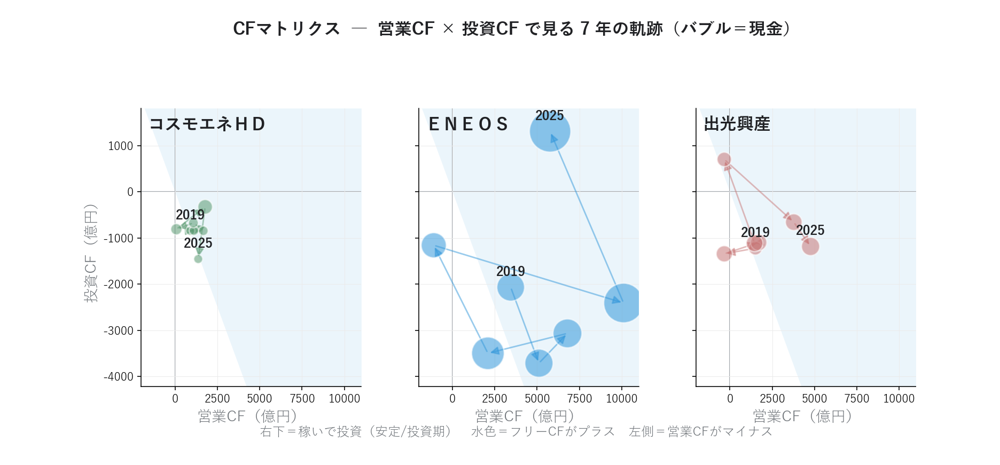
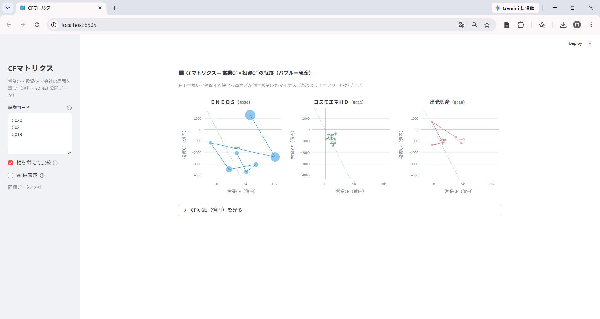

# 決算ＸＢＲＬをＪＳＯＮに変換 ― 「決算そのもの」を分析、元売3社を比較

{width="1280"}

企業が有価証券報告書を金融庁（ＥＤＩＮＥＴ）に提出するときは、決算データをＸＢＲＬという形式で出します。しかし、ＸＢＲＬは複雑な構造で、そのまま分析に使うのは現実的ではありません。そのため、**ＸＢＲＬをＪＳＯＮという形式に変換**する必要があります。

本記事では、 取得したＸＢＲＬをＪＳＯＮ化し、代表的な財務指標の時系列推移を可視化します。そこで見えてきたのが、ＥＮＥＯＳのピークアウトです。

データ出典 <i class="fa-solid fa-caret-right"></i>ＥＤＩＮＥＴ：有報ＸＢＲＬ <i class="fa-solid fa-caret-right"></i>TDnet：決算短信ＸＢＲＬ

<a class="ref-card ref-card--quiet" href="https://developer.mozilla.org/ja/docs/Learn/JavaScript/Objects/JSON" target="_blank" rel="noopener">

ＪＳＯＮとは
構造化データを表す標準のテキスト形式 ― ＭＤＮ Web Docs

</a>

## ＸＢＲＬをＪＳＯＮに変換する

ＸＢＲＬは、要素（タグ）と文脈（context）で値を表すＸＭＬです。ただし同じ「売上高」でも、会計基準や業種でタグが違います。

| 課題 | 例 |
| --- | --- |
| 会計基準でタグが違う | 売上 ＝ `NetSales`（日本基準）/ `RevenueIFRS`（ＩＦＲＳ） |
| 業種別タクソノミがある | 石油・ガス業は `jpigp_cor:` の独自タグ |
| 文脈が分離される | 当期 / 前期 / 連結 / 個別が context の組み合わせで決まる |
| 1 ファイルに数百タグ | 必要な財務項目はそのうち 40 程度 |

そこで対応表を作成して、**分析できるかたちの「ＪＳＯＮ」** に変換します。ＪＳＯＮに変換した後は、Python の数行で全銘柄を横串分析できます。

## ＪＳＯＮ化した有報で、元売 3 社の 7 年を読む

有報ＸＢＲＬは過去年度分も無料で取得でき、業績指標の時系列を表現できます。ここでは、2023〜2025 年提出の有報 3 本（主要経営指標 5 年表）を重ねて 2019/3〜2025/3 の 7 期分を構成し、代表的な業績指標を使って石油元売 3 社のチャートを作成しました。後の記事では、ＪＳＯＮ化したデータを使い、アクルーアル分析やセグメント分析など、さらに深い分析を行っていきます。

### 規模は回復、財務体質はむしろ改善

売上高（左）と自己資本比率（右）を、同じ 7 年で重ねたチャートです。

<i class="fa-solid fa-expand"></i> クリックで拡大

使用データ <i class="fa-solid fa-caret-right"></i>ＥＤＩＮＥＴ（有報ＸＢＲＬ）：売上高 / 自己資本比率（2019〜2025年3月期の7期分、主要経営指標の時系列で構成）

{width="1200"}

- 売上高はＥＮＥＯＳ・コスモが 2021 年を底に回復、出光は 2019 年が底（2021 年に一度くぼむ）、規模では ━ **ＥＮＥＯＳ** が突出
- 自己資本比率は **3 社とも上昇** ― 規模を取り戻しながら財務体質はむしろ強化
- とくに ━ **コスモエネＨＤ** は 2020 年 15% → 2025 年 27% へ大幅改善、ＥＮＥＯＳ・出光も 30% 台へ
- 「規模（売上）」と「体質（自己資本比率）」を重ねると、1 期の損益では見えない安定度まで読める

### 3 社とも 2022 がピーク ― そして直近ピークアウト

純利益（左）とＲＯＥ（右）の 7 年推移です。

<i class="fa-solid fa-expand"></i> クリックで拡大

使用データ（在庫評価損益調整なし） <i class="fa-solid fa-caret-right"></i>ＥＤＩＮＥＴ（有報ＸＢＲＬ）：純利益 / ＲＯＥ（2019〜2025年3月期の7期分、主要経営指標の時系列で構成）

{width="1200"}

※ コスモエネＨＤ・出光興産の 2020 年ＲＯＥは赤字で報告値が非開示のため、純利益÷自己資本で簡易補完しています。 ※ 本記事のチャートは有報ＸＢＲＬの<strong>報告値そのまま</strong>で、石油元売の利益・ＲＯＥに含まれる<strong>在庫評価損益</strong>（原油価格の変動で在庫の評価額が膨らむ／縮む会計上の差）は調整していません。2022 年の純利益・ＲＯＥの山は在庫評価益で水増しされた見かけの数値で、各社が決算説明資料で別途開示する「在庫影響除き」の実力利益とは別物です。利益が現金を伴っているかは、後の「アクルーアル分析」で営業ＣＦと突き合わせて検証します。

- 純利益は 3 社そろって **2022 年がピーク**（━ **ＥＮＥＯＳ** 5.4 千億円）― 原油高で在庫評価益が膨らんだ特殊年
- ＲＯＥも一時 **20〜35%** まで急騰、しかし直近は優良ライン（ＲＯＥ 10%）前後まで低下
- **「2022 の記憶」と「足元の実力」のギャップ**が鮮明（2025 はのれん減損などの一時要因も含む）
- 1 期だけ見ると見誤るが、**7 年スパンで並べると構造が一目**

### 営業ＣＦは健在 ― 利益より「嘘をつきにくい」

営業・投資・財務の 3 つのキャッシュフローを、3 社分並べたチャートです。

<i class="fa-solid fa-expand"></i> クリックで拡大

使用データ <i class="fa-solid fa-caret-right"></i>ＥＤＩＮＥＴ（有報ＸＢＲＬ）：営業 / 投資 / 財務ＣＦ（2019〜2025年3月期の7期分、主要経営指標の時系列で構成）

{width="1200"}

- 純利益が落ちても ━ **営業ＣＦ** は概ねプラス基調（ＥＮＥＯＳ 2023、出光 2020・2023 は運転資本要因で一時マイナス）― 本業の現金創出力は健在
- ━ 投資ＣＦ・━ 財務ＣＦと並べると、稼いだ現金を「投資に回したか／株主に返したか」まで読める
- **利益は会計処理で動くが、現金の出入りは動かしにくい** ― この視点は後の「アクルーアル分析」で深掘り

### ＣＦマトリクス ― 「稼ぐ力 × 投資」で会社の局面を読む

営業ＣＦを横軸・投資ＣＦを縦軸に取り、年ごとの点を結ぶと、会社が「**稼いで投資する**」局面にいるか、それとも「**稼げていない**」局面かが地図のように読めます。これを **ＣＦマトリクス** と呼びます。横軸の右ほど本業で稼ぎ、縦軸の下ほど投資にお金を回している状態です。

<i class="fa-solid fa-expand"></i> クリックで拡大

使用データ <i class="fa-solid fa-caret-right"></i>ＥＤＩＮＥＴ（有報ＸＢＲＬ）：営業ＣＦ / 投資ＣＦ / 現金（2019〜2025年3月期の7期分、主要経営指標の時系列で構成）

{width="1200"}

- 3 社とも平常時は **右下（営業＋・投資−）＝稼いで投資する局面** にいて、フリーＣＦ（水色）もプラス基調 ― 本業で稼ぎ、設備に投じる王道の形
- **ＥＮＥＯＳ 2023 だけ営業ＣＦがマイナスに振れ、左へ大きく外れる** ― ただし運転資本の一時要因で、翌 2024 年は営業ＣＦ 1 兆円超で右へ戻る
- 現金（バブル）は 7 年で総じて厚みを増し、営業ＣＦが左へ振れた年も **手元資金で吸収できる体力** がある ― フリーＣＦがプラスの年に蓄えた現金が効く

## まとめ

- ＸＢＲＬはタグ・文脈が複雑（会計基準・業種で別タグ）― **対応表でＪＳＯＮに正規化** すれば、数行で全銘柄を横串分析できる
- 元売 3 社の 7 年：売上はＥＮＥＯＳ・コスモが 2021 年・出光が 2019 年を底に回復、**自己資本比率は 3 社とも改善** ― 規模と体質を重ねて読む
- 純利益は 3 社そろって **2022 年がピーク**（在庫評価益の特殊年）― 直近はピークアウトし、ＲＯＥは優良ライン前後へ
- **営業ＣＦは健在** ― 利益より現金は嘘をつきにくい。この視点がアクルーアル分析へつながる

## <i class="fa-solid fa-chart-line"></i> 公開サイトで試す

この記事でＪＳＯＮにした**有報のデータ**（売上・ＲＯＥ・自己資本比率・営業ＣＦなど）を、東証の主要企業（約500社）の分まで、ブラウザで探して・比べられるサイトを公開しています。元売 3 社も、会社と期を選ぶだけで、**ＲＯＥと自己資本比率の関係**を見られます（期は「1 期前」〜「4 期前」に切り替えられます）。

<a class="repo-link" href="https://minnanosaiban.github.io/company-analysis/#/valuation?m=co&co=E24050,E01084,E31632&x=equity_ratio&y=roe&lab=1" target="_blank" rel="noopener">
minnanosaiban.github.io/company-analysis（元売3社のＲＯＥ × 自己資本比率）
<i class="repo-link-arrow fa-solid fa-arrow-up-right-from-square"></i>
</a>

<a class="repo-link" href="https://minnanosaiban.github.io/company-analysis/#/compare?cc=E24050,E01084,E31632" target="_blank" rel="noopener">
minnanosaiban.github.io/company-analysis（元売3社の最新期を、表と棒グラフで比べる）
<i class="repo-link-arrow fa-solid fa-arrow-up-right-from-square"></i>
</a>

## <i class="fa-brands fa-github"></i> Python コード

本記事のチャート画像・アプリ・データ取得・成形スクリプトは、すべて **GitHub に公開**しています。データは提供元の利用規約により再配布できませんが、データを各自取得すれば、この記事と同じものが再現できます（動かし方はリポジトリの README 参照）。

<a class="repo-link" href="https://github.com/minnanosaiban/blog/tree/main/01-03_xbrl_json" target="_blank" rel="noopener">
github.com/minnanosaiban/blog/01-03_xbrl_json
<i class="repo-link-arrow fa-solid fa-arrow-up-right-from-square"></i>
</a>

## 📌 自作アプリ紹介

**― キャッシュフローマトリクス ―**

<a class="repo-link" href="https://github.com/minnanosaiban/blog/tree/main/01-03_xbrl_json" target="_blank" rel="noopener">
github.com/minnanosaiban/blog/01-03_xbrl_json
<i class="repo-link-arrow fa-solid fa-arrow-up-right-from-square"></i>
</a>

証券コードを入力するだけで、本記事の **キャッシュフローマトリクス（営業ＣＦ × 投資ＣＦ）を会社ごとにブラウザで並べて**表示する Streamlit アプリ（`app_cf_matrix.py`）です。有報ＸＢＲＬ（ＥＤＩＮＥＴ公開データ）を読むので、**無料で何社でも比較**できます。

<i class="fa-solid fa-expand"></i> クリックで拡大

{width="1200"}

---
